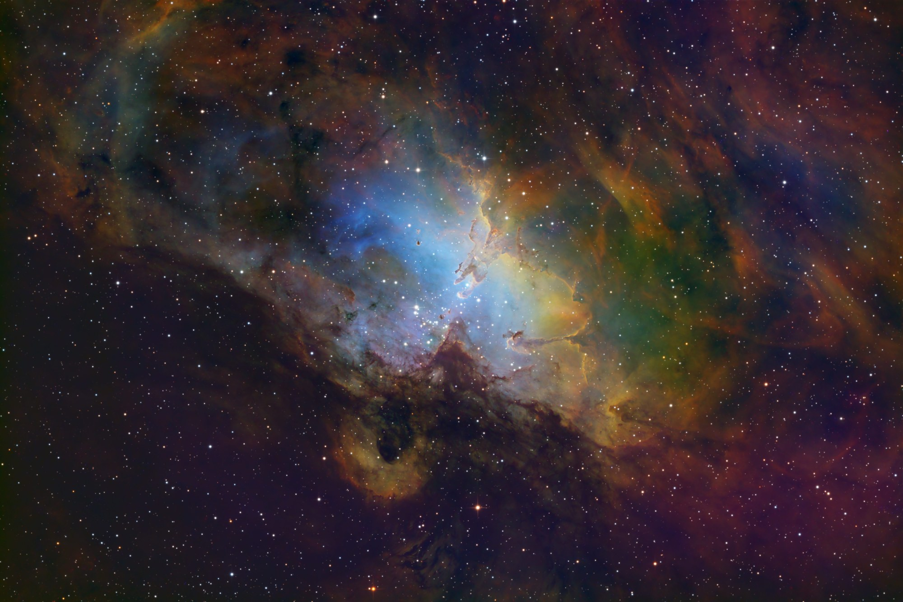
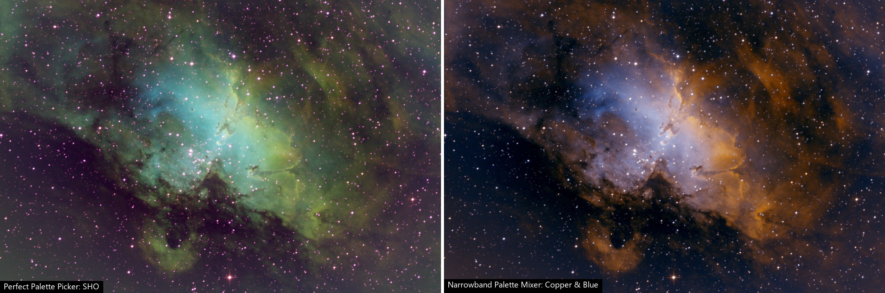
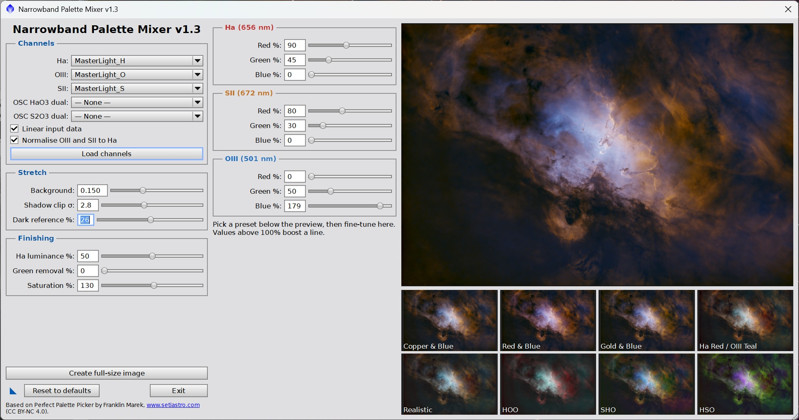
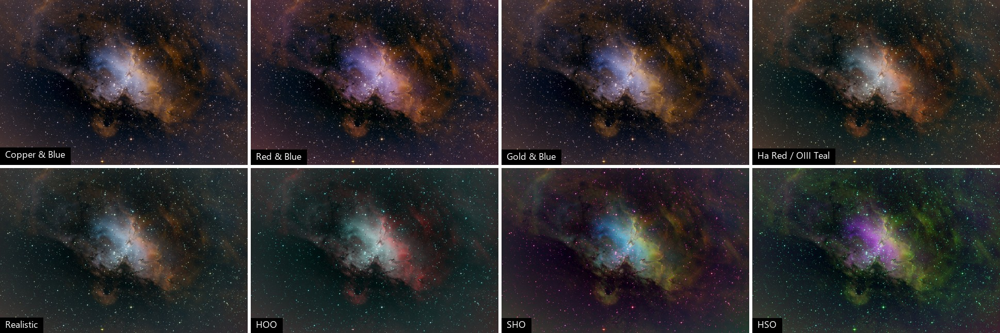

# Narrowband Palette Mixer

A PixInsight script that combines Ha, OIII and SII masters into a colour
image. You set how much of each line goes into red, green and blue with
sliders, and a live preview updates as you drag. The default palette gives the
copper-and-blue look popular for SHO images, without the green.

*M16, the Eagle Nebula, processed with Narrowband Palette Mixer.*

The mixer is based on
[Perfect Palette Picker](https://www.setiastro.com) by Franklin Marek
(SetiAstro).

## Features

- **Colour mixer:** nine sliders set the percentage of Ha, SII and OIII sent to
  red, green and blue (0–200%).
- **Live preview:** the preview and the full-size output use the same code,
  so what you see is what you get.
- **Presets:** eight preset tiles, rendered from your own data. Click one to
  load it into the sliders, then fine-tune.
- **Channel normalisation:** OIII and SII are scaled to Ha's signal level
  before mixing, so weak lines aren't swamped by Ha.
- **Adjustable stretch:** you set the background level after the stretch
  instead of getting a fixed, heavy stretch.
- **Neutral background:** dark areas stay neutral whatever the mix.
- **Finishing controls:** Ha luminance for detail, green removal and
  saturation.
- **Process icons:** save the current settings and channel choices as a
  process icon and reuse them later.
- **OSC dual-band support:** accepts colour images taken through Ha/OIII and
  SII/OIII dual-band filters, as well as mono masters.

*The same gradient-corrected M16 masters, stars not removed. Left: Perfect
Palette Picker's SHO palette, with each channel stretched separately. Right:
this mixer's Copper & Blue preset.*

## Requirements

PixInsight 1.9.4 or later.

## Install

1. Download [`NarrowbandPaletteMixer.js`](NarrowbandPaletteMixer.js) into a
   folder of your choice.
2. In PixInsight, select **Script > Feature Scripts...**
3. Click **Add**, select the folder, and click **Done**.

The script then appears under **Script > Custom > Narrowband Palette Mixer**.

To try it without installing it, select **Script > Execute Script File...**
and choose the file.

## Use the mixer

1. Open your linear Ha, OIII and SII masters. They must be registered and
   the same size. Run gradient removal on each one first.
2. Run the script. The channel lists preselect masters with names like
   `..._FILTER-H_...` or `MasterLight_H`. Check the selections, and correct
   them if needed.
3. Click **Load channels**. The preview and preset tiles appear.
4. Click the preset closest to the look you want, then adjust the sliders.
5. Click **Create full-size image**. The result opens in a new window named
   after the preset, or `Palette_Custom` if you've changed the mix.

The script remembers your last settings between runs. The settings used for
each image are also recorded in its FITS header history.

### Channels

| Control | What it does |
|---|---|
| Ha, OIII, SII | Mono masters for each line. If SII is missing, Ha is used in its place, and the other way round. |
| OSC HaO3 dual | A colour image taken through a Ha/OIII filter. Red becomes Ha; the mean of green and blue becomes OIII. |
| OSC S2O3 dual | A colour image taken through a SII/OIII filter. Red becomes SII; the mean of green and blue becomes OIII. |
| Linear input data | Leave this checked for unstretched masters. Uncheck it if the channels are already stretched, and the mixer won't stretch them again. |
| Normalise OIII and SII to Ha | Scales OIII and SII to Ha's signal level. Without this, weak lines barely show. |

### Stretch

| Control | What it does |
|---|---|
| Background | Brightness of the background after the stretch. Lower values give a gentler stretch that leaves room to stretch further later. Perfect Palette Picker uses 0.25. |
| Shadow clip σ | How far below the background the black point sits, in noise standard deviations. Lower values give deeper blacks. |
| Dark reference % | The percentile of each channel treated as neutral black. Lower it if dark dust lanes show a colour cast, usually blue. At 50% it uses the median. It changes colour balance only, not brightness. |

### Colour mix

Each line has red, green and blue sliders from 0 to 200%. For example, the
Copper & Blue preset sends:

| Line | Red | Green | Blue |
|---|---|---|---|
| Ha | 90% | 45% | 0% |
| SII | 80% | 30% | 0% |
| OIII | 0% | 50% | 140% |

To shift a colour, change the green share. For example, less green on OIII
gives a deeper blue, and more green on Ha gives a more golden copper.

### Finishing

| Control | What it does |
|---|---|
| Ha luminance % | How much of the image brightness comes from Ha, which usually has the best signal and detail. The colour still comes from the mix. |
| Green removal % | Reduces green where it exceeds the mean of red and blue, like SCNR. Useful with SHO-style mixes. |
| Saturation % | Colour saturation. 100% leaves it unchanged. |

## Save settings as a process icon

Drag the **New Instance** button (the triangle at the lower left) onto the
workspace. This saves the current mix, stretch and finishing settings, and the
channel selections, as a process icon.

Open the icon to start the mixer with those settings. If the saved channel
images are open, the mixer loads them straight away.

## Tips

- **Remove gradients first:** normalisation can boost OIII and SII by 5–10×,
  so a gradient that's hard to see in a master becomes an obvious colour cast.
  Run DBE, GraXpert or a similar tool on each linear master before mixing.
- **Handle stars separately:** stars come out pink or magenta because the
  boosted lines have different star profiles. For the best results, run the
  mixer on starless masters and add RGB stars back afterwards.
- **Reduce noise first:** normalisation boosts noise along with signal. Noise
  reduction on the linear OIII and SII masters helps.
- **Leave room to stretch:** it's easier to stretch a little more later than to
  recover detail from an over-stretched image.

## How it works

1. For each channel, the script measures the median and noise at full
   resolution, and the signal level (95th percentile) on a downsampled copy.
   Pixels clipped to zero, such as registration borders, are ignored.
2. OIII and SII are scaled so their signal above background matches Ha's.
3. Each output channel is a weighted sum of the lines, offset so that every
   channel has the same value where each line sits at its dark reference.
   This keeps dark areas neutral for any mix.
4. One linked stretch is applied to all channels, like a linked STF. Stretching
   each channel separately would stretch a boosted, noisier line less and
   shift the colour balance.
5. Ha luminance, green removal and saturation are applied, in that order.

## Credits and licence

Based on Perfect Palette Picker v1.3 by Franklin Marek,
[www.setiastro.com](https://www.setiastro.com). This derivative is licensed
under the same
[Creative Commons Attribution-NonCommercial 4.0 International](LICENSE)
licence. You can share and adapt it for non-commercial use, with attribution.
